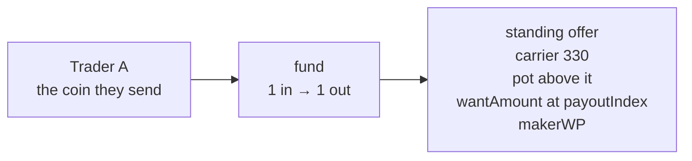
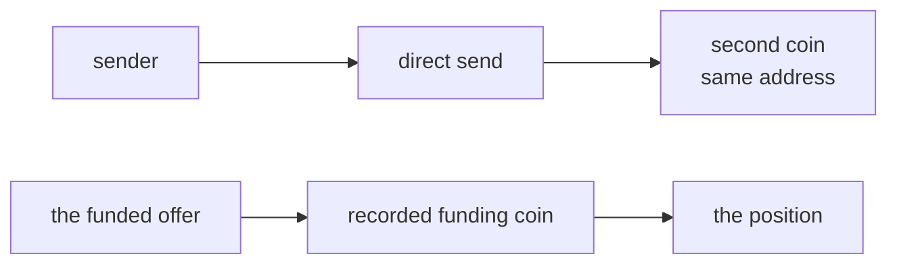
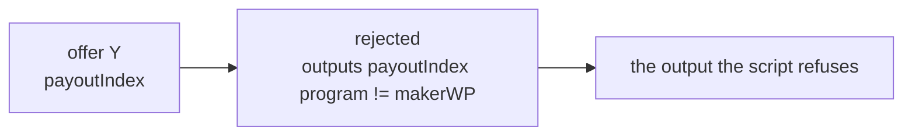
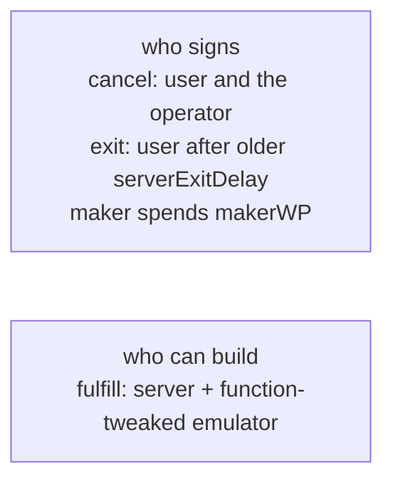

# Standing match

Trader A funds swap contract X with one coin. Trader B funds swap contract Y with another. Each funding is an ordinary send, and the funder does not come back to sign the trade. A third party spends X and Y together. `fulfill` has no user signature. The operator and the emulator cosign it, and only when every `require` passes.

X pays the maker on `outputs[payoutIndex]`. Y uses a different index. One output cannot satisfy both. The deposit is not a constructor field. The contract does not inspect what it holds. If Y is never funded, the coin stays in X. `cancel` returns it: the funder and the operator, no timelock. `exit` is the unilateral path after `older(serverExitDelay)`. There is no fill deadline.

## The coin the trader sends

Trader A funds the address. That output is the standing offer: carrier 330, and the pot is the sats above it.

## The direct send

A direct send to the same address creates a second coin beside the funded offer. Only the recorded funding coin is the position.

## The rejected transaction

Y's `fulfill` reads `outputs[payoutIndex]`. A transaction that pays the maker on the other output fails that `require`. It may not balance.

## Who signs

`fulfill` is the server plus the function-tweaked emulator. Anyone who can build that transaction can pass the `require`. `cancel` is the funder's key and the operator. `exit` is the funder after `older(serverExitDelay)`. The maker spends `makerWP` by spending the script that output pays.

A `require` is not authorization. It checks the transaction. It does not identify who may move the coins.

Enforced: `outputs[payoutIndex]` is a version-1 program equal to `makerWP`, carrying at least `wantAmount` of the named asset or at least `wantAmount` sats. `cancel` is the funder and the operator. `exit` waits for `serverExitDelay`.

Not claimed: operator liveness, that the deposit is any particular asset, or a destination the script does not pin.
