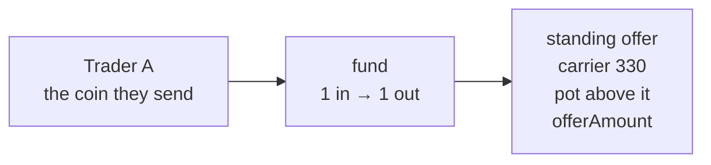
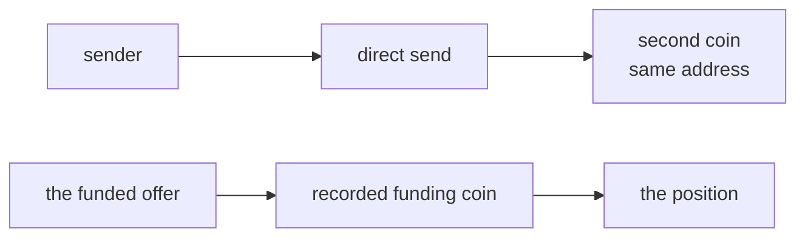
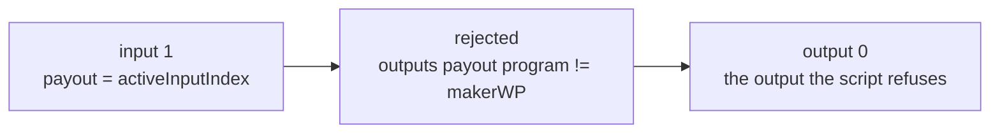
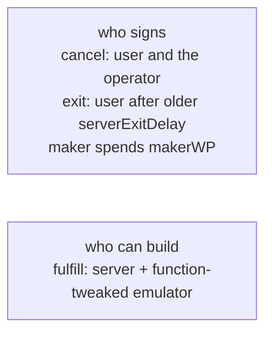

# Standing match

`MatchedSwap` is one contract. Trader A funds it. Trader B funds another instance. Each funding is an ordinary send, and the maker does not come back to sign. A matcher spends the two coins as the two inputs of one transaction. `fulfill` has no user signature. The operator and the emulator cosign it, and only when every `require` passes.

`payout` is `this.activeInputIndex`. The other input is `1 - payout`. This input carries exactly `offerAmount` of one offer asset. The counterparty input carries `received` of the want asset, and `received` is at least `wantAmount`. Output `payout` pays the maker's version-1 program exactly `received` of that asset, with at least as many sats as this input. The offer asset and the want asset both have `delta == 0`. There is no third input and no continuation.

`cancel` is the maker and the operator, with no timelock. `exit` is the maker after `older(serverExitDelay)`. `serverExitDelay` is reserved. The deposit is not a constructor field.

## The coin the trader sends

Trader A funds the address. That output is the standing offer: carrier 330, and the pot is the sats above it. The offer asset on that coin is `offerAmount`.



## The direct send

A direct send to the same address creates a second coin beside the funded offer. Only the recorded funding coin is the position.



## The rejected transaction

Input 1 sets `payout` to `this.activeInputIndex`. A transaction that pays both makers on output 0 fails `outputs[payout].program == makerWP` for that input. It may not balance.



## Who signs

`fulfill` is the server plus the function-tweaked emulator. Anyone who can build that transaction can pass the `require`. `cancel` is the maker's key and the operator. `exit` is the maker after `older(serverExitDelay)`. The maker spends `makerWP` by spending the script that output pays.



A `require` is not authorization. It checks the transaction. It does not identify who may move the coins.

Enforced: `tx.numInputs == 2`, this input's offer asset is exactly `offerAmount`, the counterparty input's want asset is `received >= wantAmount`, and output `payout` pays `makerWP` exactly `received` with at least this input's sats. Both asset deltas are 0.

Not claimed: operator liveness, that `cancel` chooses a destination, or that a wish can be filled in part.

## Security

### One output satisfies both

Claim: each maker is paid on the output at `this.activeInputIndex`.

Attack: the matcher builds one output and both scripts accept it.

`payout = this.activeInputIndex`, and `outputs[payout]` must be that maker's version-1 program carrying `received`. The two inputs therefore name different outputs.

Left open: `cancel` still needs the maker and the operator. It has no covenant, so the coins go where that spend says.

### Skim of the surplus

Claim: the maker receives the counterparty's whole deposit.

Attack: the matcher pays `wantAmount` and keeps the rest.

`received` is the want asset on the counterparty input, and `outputs[payout]` must carry exactly `received`.

Left open: there is no residual order. This is a full cross. A counterparty who deposited more than the wish pays the extra to the maker.

### A third input fronts the payout

Claim: the two deposits are the only inputs, and each deposit is the other maker's payout.

Attack: a third input pays the makers, and the deposits are paid to the attacker.

`tx.numInputs == 2`. Each input carries one asset, and both asset deltas are 0, so the offer asset and the want asset move from those two inputs onto the two maker outputs.

Left open: `exit` still needs the maker after `older(serverExitDelay)`. That path spends one unrolled coin. It does not run the cross.

## Version check

`recipient.version == 1` compares integers, so the compiler emits `OP_NUMEQUALVERIFY` after `OP_INSPECTOUTPUTSCRIPTPUBKEY`. The inspect opcode pushes the witness version as a script number. Numeric equality accepts the minimal encoding of 1 and rejects every other version. A non-minimal encoding fails the numeric opcode, so it cannot pass as version 1. `OP_EQUALVERIFY` is the byte compare the compiler uses for the program, which is a byte string.

## Setup

`arkade.programFromArtifact` does not verify the artifact fingerprint. The regtest checks it.

The compiler and the regtest stack are local clones. Both directories stay gitignored.

```bash
git clone --depth 1 https://github.com/arkade-os/compiler.git compiler
cargo run --manifest-path compiler/Cargo.toml --release -- contracts/matched_swap.ark -o contracts/matched_swap.artifact.json

git clone --depth 1 https://github.com/ArkLabsHQ/arkade-regtest.git regtest
printf 'AUTOMINE_INTERVAL=0\n' > .env.regtest
node regtest/regtest.mjs start --env .env.regtest --profile ark --profile emulator

pnpm install
pnpm test
```

Node is pinned to 22.23.4 in `.nvmrc` and `package.json` `engines`. The test script uses `node --experimental-strip-types`.
